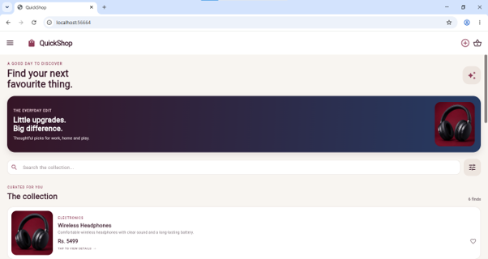
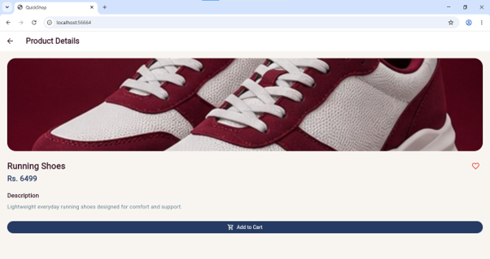
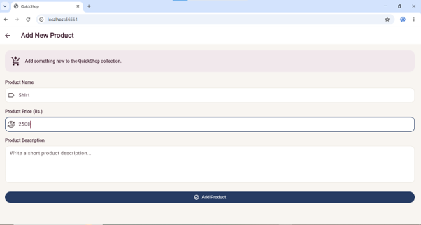
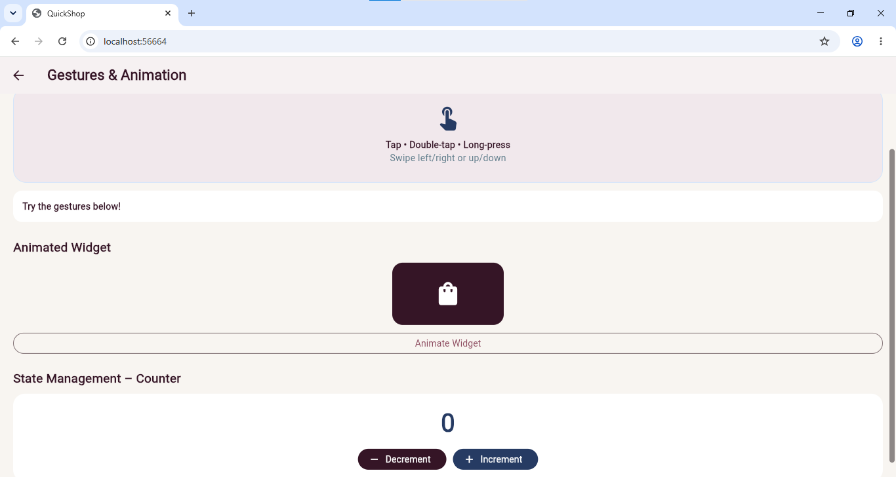
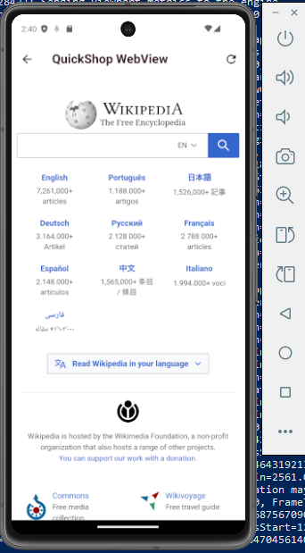
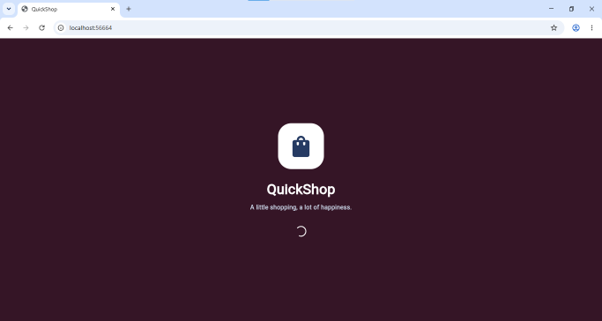
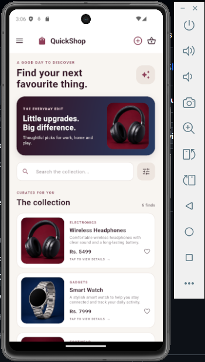
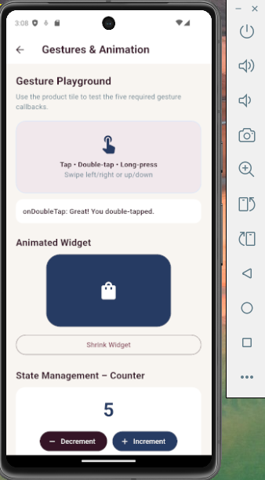
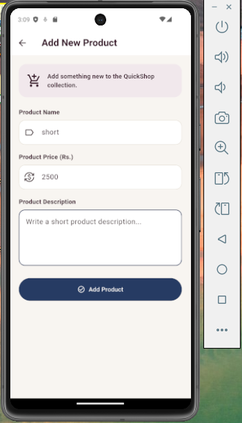

<div align="center">

# 🛍️ QuickShop

### A clean, colorful shopping experience built with Flutter

Explore products, view details, add products, and interact with a simple shopping app interface.


**A Flutter Mobile Computing project by [Huda Tariq](https://github.com/Hudatariq103)**

[View Repository](https://github.com/Hudatariq103/QuickShop-App-) · [Report an Issue](https://github.com/Hudatariq103/QuickShop-App-/issues)

</div>

---

## ✨ About QuickShop

QuickShop is a beginner-friendly shopping app developed using **Flutter and Dart**. It focuses on a neat, easy-to-navigate interface while practicing Flutter screen structure, reusable widgets, navigation, and interactive UI elements.

The app uses a burgundy, midnight-blue, and warm-ivory visual theme, with coordinated product images.

## 📱 App Screenshots

Create a folder named `screenshots` in the project root and add your screenshots using the exact filenames below. They will appear here automatically after you push them to GitHub.

### 🏠 Home Screen



### 📦 Product Details



### ➕ Add Product



### 🎬 Gestures & Animations



### 🌐 WebView



### 🚀 Splash Screen



## 📧 Email Screenshots

Here are some screenshots of the emails related to the project:

<p align="center">
  
  
  
</p>

---

## 🌟 Features

- **Splash screen** — an introductory screen when the app starts.
- **Product catalogue** — browse a selection of products with images.
- **Search and category filtering** — find products in the catalogue.
- **Product details** — open a product to view its details.
- **Add product screen** — access the interface for adding a product.
- **Gestures and animations** — explore interactive Flutter UI behavior.
- **WebView screen** — display web content on supported Android devices.
- **Reusable components** — product UI is organized into reusable widgets.
- **Organized code** — screens, theme, widgets, and product model are kept in separate files.

## 🧰 Built With

| Technology | Purpose |
|---|---|
| [Flutter](https://flutter.dev/) | App UI framework |
| [Dart](https://dart.dev/) | Programming language |
| Material Design | UI components and styling |
| WebView Flutter plugin | Web content on Android |

## 📁 Project Structure

```text
QuickShop/
├── android/
├── assets/
│   └── products/
│       ├── backpack.jpg
│       ├── camera.jpg
│       ├── headphones.jpg
│       ├── mug.jpg
│       ├── shoes.jpg
│       └── watch.jpg
├── lib/
│   ├── main.dart
│   ├── app.dart
│   ├── models/
│   │   └── product.dart
│   ├── screens/
│   │   ├── splash_screen.dart
│   │   ├── home_screen.dart
│   │   ├── product_details_screen.dart
│   │   ├── add_product_screen.dart
│   │   ├── gesture_animation_screen.dart
│   │   └── web_view_screen.dart
│   ├── theme/
│   │   └── app_theme.dart
│   └── widgets/
│       └── product_card.dart
├── test/
├── pubspec.yaml
├── pubspec.lock
└── README.md
```

## 🚀 Getting Started

### 1. Prerequisites

- [Flutter SDK](https://docs.flutter.dev/get-started/install)
- [Android Studio](https://developer.android.com/studio) (for Android emulator)
- [Visual Studio Code](https://code.visualstudio.com/) (optional editor)
- Git

Check your Flutter setup:

```bash
flutter doctor
```

### 2. Clone the repository

```bash
git clone https://github.com/Hudatariq103/QuickShop-App-.git
```

### 3. Open the project folder

```bash
cd QuickShop-App-
```

### 4. Install dependencies

```bash
flutter pub get
```

### 5. Run the app

**On an Android emulator or connected device:**

```bash
flutter devices
flutter run
```

**In Chrome:**

```bash
flutter run -d chrome
```

> **Note:** The WebView experience is intended for Android. When running in a browser, the app may show a platform-specific message instead of embedding a WebView.

## 🧑‍💻 Useful Flutter Commands

```bash
# Check Flutter setup
flutter doctor

# Get project dependencies
flutter pub get

# List available devices
flutter devices

# Run on a connected device or emulator
flutter run

# Run in Chrome
flutter run -d chrome

# Run tests
flutter test
```

## 🎨 Design

QuickShop uses a coordinated **burgundy, midnight-blue, and warm-ivory** palette. The layout is simple and product-focused, with clear sections and product imagery.

## 📚 Learning Goals

This project provides practice with:

- Structuring a Flutter application across multiple Dart files.
- Building screens with Flutter widgets.
- Reusing UI through custom widgets.
- Organizing product data with a model.
- Applying a consistent app theme.
- Implementing navigation and interactive UI elements.
- Working with assets and platform-specific functionality.

## 🔮 Future Improvements

Ideas for future versions:

- Add persistent product storage.
- Add cart and checkout functionality.
- Add user authentication and profiles.
- Improve product management with edit and delete actions.
- Add more product categories and filtering options.

## 👩‍🎓 Author

**Huda Tariq**  
BS Information Technology

- GitHub: [@Hudatariq103](https://github.com/Hudatariq103)

---

<div align="center">

### 💖 Thanks for checking out QuickShop!

If you find this project helpful, consider giving the repository a ⭐

**Made with Flutter & a little creativity.**

</div>
